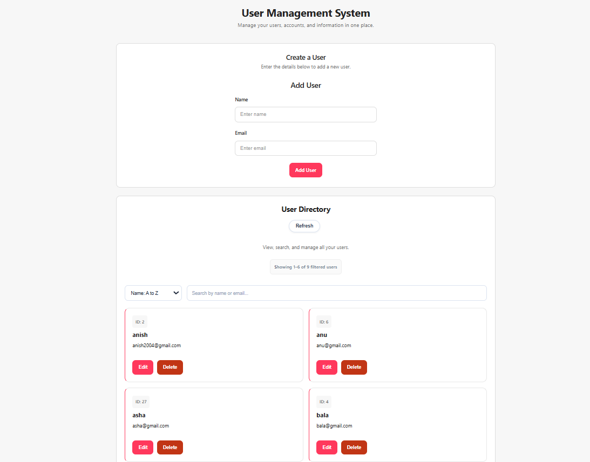

# User Management System — Frontend

A full-stack User Management System built with **React, Java Spring Boot, and MySQL**. This project demonstrates frontend development, REST API integration, CRUD operations, data validation, and deployment.

## 📸 Project Preview



## 🚀 Live Demo

**[Open the Live Application](https://user-management-system-frontend-swart.vercel.app/)**

The application communicates with a Spring Boot REST API and stores user records in MySQL.

## ✨ Features

- **Create users** — Add a user with a name and email address.
- **View users** — Retrieve and display user records from the backend.
- **Update users** — Edit existing user information.
- **Delete users** — Remove records with a custom confirmation modal.
- **Search** — Find users by name or email.
- **Sorting** — Sort users alphabetically in ascending or descending order.
- **Pagination** — Navigate through records and choose 6, 10, or 20 users per page.
- **Error handling** — Display helpful messages for duplicate emails and server errors.
- **API integration** — Communicate with the backend using Axios.

## 🛠️ Tech Stack

| Technology | Purpose |
|---|---|
| React | User interface |
| JavaScript | Application logic |
| Vite | Frontend development and build tool |
| Axios | HTTP requests to the backend |
| HTML and CSS | Structure and styling |
| Java and Spring Boot | Backend REST API |
| MySQL | Database |
| Git and GitHub | Version control |
| Vercel | Frontend deployment |
| Render | Backend deployment |
| Aiven | Hosted MySQL database |

## 🏗️ Architecture

```text
React Frontend (Vercel)
        |
        | Axios / HTTP
        v
Spring Boot REST API (Render)
        |
        | Spring Data JPA
        v
MySQL Database (Aiven)
```

## 🔗 Related Repository

**Backend:** [user-management-system-backend](https://github.com/Anish-D1/user-management-system-backend)

The backend exposes REST endpoints under `/api/users` for creating, retrieving, updating, and deleting user records.

## 💻 Run Locally

### Prerequisites

- Node.js and npm
- Java 21
- Maven
- MySQL

### 1. Clone the repository

```bash
git clone https://github.com/Anish-D1/user-management-system-frontend.git
cd user-management-system-frontend
```

### 2. Install dependencies

```bash
npm install
```

### 3. Configure the backend URL

Create a `.env` file in the project root:

```env
VITE_API_URL=http://localhost:8080
```

For local development, ensure the Spring Boot backend and MySQL database are configured and running.

### 4. Start the frontend

```bash
npm run dev
```

Open the local URL printed by Vite in your terminal, usually `http://localhost:5173`.

### 5. Build for production

```bash
npm run build
```

The production build is generated in the `dist` directory.

## 🔌 API Endpoints

| Method | Endpoint | Purpose |
|---|---|---|
| GET | `/api/users` | Retrieve users |
| POST | `/api/users` | Create a user |
| PUT | `/api/users/{id}` | Update a user |
| DELETE | `/api/users/{id}` | Delete a user |

The backend validates incoming data and rejects duplicate email addresses.

## 📚 What I Practised

- Building a React application with reusable state-driven UI.
- Integrating a frontend with REST APIs using Axios.
- Managing form input, loading states, and server responses.
- Implementing search, sorting, and pagination.
- Handling database constraint errors gracefully.
- Configuring environment variables for deployment.
- Deploying and connecting a frontend, backend, and hosted database.

## 🔒 Notes

This is a portfolio and learning project. Authentication and authorization are not currently implemented. Use demo data only; do not enter real personal or sensitive information.

## 👨‍💻 Author

**Anish Devan**

Aspiring Java Full-Stack Developer

[GitHub Profile](https://github.com/Anish-D1)
